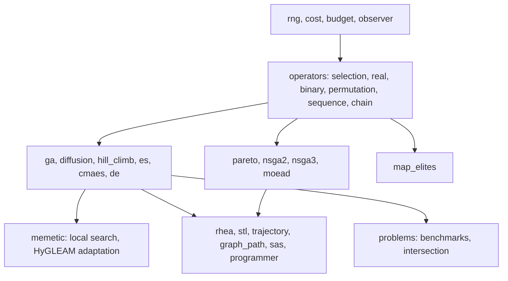

# evolutionary-planning: design

Status: draft on branch `draft/initial`. All five milestones are implemented; see
[Milestones](#milestones) and [Deviations](#deviations).

## Goal and scope

`evolutionary-planning` searches over plans, paths and trajectories with evolutionary
algorithms. A caller supplies a genome type, an objective and variation operators (or picks
the ready-made ones for real vectors, bit strings, permutations and action chains) and gets
back the best solutions found, a Pareto front or an archive of diverse elites.

In scope, grouped by family:

- **Core.** Genome-agnostic operator traits (initialisation, selection, crossover, mutation,
  repair), ready-made operators for real vectors, bit strings, integer strings, permutations
  and GLEAM action chains, a seeded deterministic generator, budgets, observers.
- **Single objective.** Generational and steady-state genetic algorithms (GA) with elitism;
  GLEAM's ring-structured diffusion model; random-mutation hill climbing (RMHC);
  (μ/ρ,λ)- and (μ/ρ+λ)-evolution strategies (ES) with self-adaptation and the (1+1)-ES with
  the 1/5th success rule; CMA-ES exactly as in Hansen's tutorial, with IPOP restarts;
  differential evolution (DE) with Latin hypercube initialisation, a warm-start library and
  the rank-based archive variant RADES.
- **Memetic.** Local searchers (RMHC, Rosenbrock's rotating-coordinate method) applied to
  offspring, with HyGLEAM's cost-benefit adaptation of local-search frequency and intensity.
- **Multi objective.** Pareto dominance with constraint domination, fast non-dominated
  sorting, crowding distance, bounded Pareto archives, exact hypervolume, NSGA-II, NSGA-III
  and MOEA/D.
- **Quality diversity.** MAP-Elites over a grid of behaviour descriptors.
- **Planning bridges.** Rolling-horizon evolutionary planning (RHEA, with RMHC as the
  population-of-one case) over a caller-supplied forward model; finite-trace signal temporal
  logic (STL) robustness as fitness or constraint, plus evolutionary fitting of STL thresholds
  from demonstrations; GA path planning on graphs and grids; online trajectory optimisation
  with warm-started CMA-ES; GA over SAS+ action sequences with plan repair (feature
  `sas-plus`); a multi-robot intersection benchmark; an evolutionary programmer that evolves
  GA configurations.

Out of scope: neural networks or learned world models (the forward model is the caller's),
LLM-driven variation (EvoPlan's neural part), parallel evaluation (the crate is `no_std`; a
caller can evaluate a batch in parallel through the ask-and-tell CMA-ES interface), and
tree-based genetic programming over arbitrary grammars (see [Open questions](#open-questions)).

Constraints:

- `no_std` + `alloc`; `forbid(unsafe_code)`, pedantic clippy, docs on every item.
- Dependencies: `rand_core` (generator trait), `libm` (`exp`, `ln`, `sqrt`, `cos` under
  `no_std`), `search-core` (the shared `Budget` trait). `sas-plus` is an optional
  dependency behind the `sas-plus` feature, read-only.

## Conventions

### Every objective is minimised

The placeholder `Fitness` trait said "larger is better". The crate instead minimises
everywhere, because plan costs (`sas-plus`'s `validate_plan`), path lengths, CMA-ES and the
multi-objective literature all minimise, and one direction across the crate avoids a whole
class of sign bugs. A caller who maximises a reward returns its negation. The forward model of
RHEA reports a per-step *cost* for the same reason (see [RHEA](#rhea-and-rmhc-planning)).

Costs are `f64`. NaN is mapped to `+∞` once, at evaluation time ([`cost::sanitize`]), so a
broken objective produces the worst individual instead of poisoning comparisons. All sorting
uses `f64::total_cmp` and breaks ties by index, so equal costs never make a run depend on the
sort algorithm.

### Randomness

All randomness comes from a caller-provided `rand_core::Rng`. The crate ships `SplitMix64`
(the same generator as `stochastic-search`), so a seed reproduces a run across releases
regardless of other crates' versions. Floating-point and integer helpers (`unit_f64`,
`below` with Lemire's unbiased method, standard normal via the polar method) live in `rng`.
No algorithm iterates a hash map. Every algorithm has a same-seed-same-result test (unit
tests, and `tests/it/determinism.rs` for the rest).

Operator traits are generic over the generator in the method
(`fn mutate<R: Rng + ?Sized>(&mut self, genome: &mut G, rng: &mut R)`), which keeps the hot
path monomorphised. Closures are accepted through `&mut dyn Rng` adapters
(`mutation_fn`, ...), because a closure cannot be generic.

### Budgets

Every population run (GA, diffusion, RMHC, ES, CMA-ES, IPOP, DE, RADES, NSGA-II/III,
MOEA/D, MAP-Elites, the SAS+ and path solvers) takes a `search_core::Budget<Stats>`;
`Limits` (evaluations, generations, target cost) implements it, and so does any `FnMut(&Stats) -> bool`, which lets a `std` caller add a
deadline. Planners that work per decision take a plain evaluation count instead: RHEA
(`Config::evaluations` per decision), the online trajectory optimiser (per replan), STL
fitting and the evolutionary programmer (per run). The budget is asked **before every
objective evaluation**, so a limit of `n`
evaluations performs exactly `n`. When a budget stops a run in the middle of a generation the
partial generation is not merged into the population, but every evaluated individual took
part in the best-so-far bookkeeping, so no evaluation is wasted for the returned result.

### Observers

`Observer` receives non-exhaustive `Event`s (`Generation`, `Improved`, `Restart`, ...) as in
`stochastic-search`; `()` disables all event bookkeeping at compile time
(`Observer::ENABLED`).

## Architecture



### Core traits

```rust
pub trait Objective<G> { fn evaluate(&mut self, genome: &G) -> f64; }          // + FnMut impl
pub trait MultiObjective<G> {
    fn objectives(&self) -> usize;
    fn evaluate(&mut self, genome: &G, out: &mut [f64]) -> f64;               // violation >= 0
}
pub trait Initializer<G> { fn initialize<R: Rng + ?Sized>(&mut self, rng: &mut R) -> G; }
pub trait Mutation<G>    { fn mutate<R: Rng + ?Sized>(&mut self, g: &mut G, rng: &mut R); }
pub trait Crossover<G>   { fn crossover<R: Rng + ?Sized>(&mut self, a: &G, b: &G, rng: &mut R) -> [G; 2]; }
pub trait Repair<G>      { fn repair<R: Rng + ?Sized>(&mut self, g: &mut G, rng: &mut R); }
pub trait Selection {
    fn select<R: Rng + ?Sized>(&mut self, costs: &[f64], count: usize, rng: &mut R, out: &mut Vec<usize>);
}
```

Combinators: `Mix` (weighted choice among mutations, GLEAM style), `Then` (apply two in
sequence), `NoRepair`. A constraint violation of `0` means feasible; constrained domination
(Deb 2000) prefers feasible over infeasible and smaller over larger violation.

### Representations

| Genome | Type | Mutations | Crossovers | Repair |
|---|---|---|---|---|
| Real vector | `Vec<f64>` + `Bounds` | Gaussian, polynomial (Deb), uniform reset | SBX, BLX-α, arithmetic, uniform | clamp, reflect |
| Bit string | `Vec<bool>` | bit flip | one-/two-point, uniform | |
| Integer string | `Vec<u32>` + domains | random reset, creep | one-/two-point, uniform | clamp |
| Permutation | `Vec<usize>` | swap, insertion, inversion, scramble | PMX, OX, CX, edge recombination | |
| Action chain | `Vec<T>` (GLEAM) | gene: parameter new value / shift; chain: gene and segment shift, inversion, insertion, deletion, duplication | n-point and segment crossover over chains of unequal length | |

GLEAM action chains (Blume and Jakob; Jakob 2021): a chromosome is a variable-length list of
typed genes, each gene an action with a configurable number of integer or real parameters
whose bounds the mutations respect. `chain::ActionModel` describes the action types; the
chain-level operators are generic over any `Vec<T>` (so a SAS+ plan, `Vec<OpId>`, uses
them unchanged) and the gene-level operators act on `chain::Action`.

## Algorithms

### Genetic algorithms

Generational: evaluate, keep `elitism` best, fill the rest by selection, crossover with
probability `crossover_rate`, mutation, repair, evaluation. Steady state: each step breeds one
or two offspring, each of which replaces the current worst individual (always, or only if
better). Selection schemes: tournament (size `k`, deterministic), truncation, roulette
(on `max - cost` shifted to positive), linear ranking with selective pressure `s ∈ [1, 2]`
(EP's 0.8..1.2 scores are `s = 1.2`), and stochastic universal sampling.

### Diffusion model (GLEAM)

Individuals sit on a ring; each one's deme is itself plus `deme/2` neighbours on each side.
Each generation, every individual (in ring order, updated in place) mates with a partner
selected from its deme by the configured selection (linear ranking in GLEAM), `k` offspring
are produced by the GLEAM operators, the best one is (optionally) locally improved, and it
replaces the centre individual according to an acceptance rule: `Always`, `LocalLeast`
(better than the deme's worst), `BetterParent`, or `LocalElitist` (better than the deme's
worst, and better than the parent if the parent is the deme's best). Two stagnation
counters (generations without improvement of any deme best, generations without any
acceptance) are the termination criteria Jakob recommends.

### Memetic hybrid (HyGLEAM)

`LocalSearch<G>` improves a genome under an evaluation cap. Provided: RMHC (any genome with a
mutation) and Rosenbrock's method (real vectors). `Adaptive` implements HyGLEAM's adaptive
single-meme scheme: a small set of intensity levels (evaluation caps) and frequency levels
(probability that an offspring is improved), each a discrete distribution adapted by
cost-benefit: every `window` local searches, the levels used in the window share their
probability mass in proportion to their mean relative gain per evaluation (moving halfway),
unused levels keep theirs, and a floor keeps every level alive. The exact rule is a
reconstruction (Jakob 2021 only sketches it; see deviations), and since benefit is measured
per local search, intensity adapts directly while frequency adapts only weakly.
Lamarckian (write back) and Baldwinian (fitness only) are both supported.

### Random-mutation hill climbing

Mutate a copy of the current genome, accept if not worse (`<=`, the tie acceptance lets it
drift across plateaus as in Olesen et al.). Optional restarts after a stagnation count.

### Evolution strategies

(μ/ρ,λ) and (μ/ρ+λ) over `Vec<f64>` with self-adaptive step sizes: one global σ (τ = 1/√n)
or one per coordinate (τ' = 1/√(2n), τ = 1/√(2√n)), intermediate recombination of ρ parents
for object variables and step sizes, discrete recombination optional. The (1+1)-ES uses
Rechenberg's 1/5th rule with factors `exp(1/3)` on success and `exp(-1/12)` on failure,
which keep σ stationary at a success rate of exactly 1/5.

### CMA-ES

Exactly Figure 6 and Table 1 of Hansen (2016, arXiv:1604.00772), including the negative
("active") weights (49)–(53), `hσ` and `δ(hσ)`, the `n/‖C^{-1/2} y‖²` rescaling (46) of
negative-weight steps and the exact `E‖N(0,I)‖` approximation. The eigendecomposition is a
cyclic Jacobi method (exact up to rounding, robust for symmetric matrices, `no_std`), run
lazily every `max(1, ⌊1/(10 n (c1 + cμ))⌋)` generations (Appendix B.2); C is symmetrised
before each decomposition. Termination criteria from Appendix B.3: NoEffectAxis,
NoEffectCoord, ConditionCov, EqualFunValues, Stagnation, TolXUp, TolFun, TolX, plus the budget.
Interfaces: ask/tell (`ask` fills λ candidates, `tell` takes their costs), `minimize` as a
convenience, and `ipop` (restarts with doubled λ, Auger and Hansen 2005). Box bounds are
handled by penalisation (63) on the repaired point when the caller asks for it. Warm start:
`CmaEs::with_covariance` takes a mean, σ and covariance from a previous run, and `CmaEs::set_mean` moves the mean of a running one.

### Differential evolution

`rand/1/bin`, `best/1/bin`, `current-to-best/1/bin`, `rand/2/bin`, with exponential crossover
as an option; Latin hypercube initialisation (one sample per stratum and dimension, strata
permuted independently); a warm-start library of solved problems keyed by a task descriptor,
which seeds part of the population when the query is within a radius (Yue et al. 2023).
RADES (Parque 2024): rank-biased parent indices (9), a success archive, and a per-individual
stagnation counter that switches between exploitation from the population and exploration
from the archive (5)–(11).

### Multi-objective

- `pareto`: dominance and constrained dominance, fast non-dominated sorting (Deb et al. 2002)
  checked against an O(n²) reference, crowding distance, a bounded archive with crowding
  truncation, exact hypervolume (sweep for 2D, HSO slicing for any dimension).
- NSGA-II: binary crowded tournament, SBX/polynomial by default, (μ+μ) environmental selection
  by rank then crowding.
- NSGA-III (Deb and Jain 2014): Das-Dennis reference points (one or two layers), ideal point,
  extreme points by achievement scalarising function, intercepts by hyperplane (falling back to
  the nadir on degenerate systems), association by perpendicular distance and niche-preserving
  selection.
- MOEA/D (Zhang and Li 2007): weight vectors, `T` nearest neighbours, Tchebycheff, weighted
  sum and PBI decompositions, neighbourhood mating probability δ and replacement limit `nr`
  (Li and Zhang 2009), optional external Pareto archive.

### MAP-Elites

A grid archive over `d` descriptor dimensions, each split into `bins[i]` equal cells within
bounds (values outside are clamped into the edge cells). Initialise with random genomes, then
repeatedly pick a uniformly random elite (and optionally a second one for crossover or
iso+line variation), vary, evaluate cost and descriptor, and insert if the cell is empty or the
newcomer is strictly better. Invariants tested: each stored elite's descriptor maps to its
cell; no inserted candidate is better than the elite of its cell; coverage and QD-score are
monotone.

### RHEA and RMHC planning

`ForwardModel { State, Action; step(state, action, rng) -> (State, cost, done) }`, supplied by
the caller (a simulator, a learned model, anything). An individual is an action sequence of
length `horizon`; its cost is the (optionally discounted) sum of step costs, averaged over
`rollouts` samples for stochastic models. Each call of `RollingHorizon::plan` evolves under a
per-decision budget and returns the first action of the best sequence; with shift buffering
the best sequence is shifted by one action and padded with a random action, and becomes the
seed of the next decision (Olesen et al. 2020). RMHC is the population-of-one configuration.

### STL

Finite-trace signal temporal logic over a trace `&[S]` with `S: AsRef<[f64]>` (time steps × signals) with the
quantitative (robustness) semantics of Donzé and Maler: predicates `x_i ≥ c` and `x_i ≤ c`,
negation, conjunction, disjunction, bounded `G[a,b]`, `F[a,b]`, `U[a,b]`. Windows are clipped
to the trace (finite-trace semantics; `G` over an empty window is `+∞`, `F` is `-∞`).
`Formula::robustness(trace)` at the first step, `Formula::signal` at every step. Uses: as an objective (maximise robustness = minimise
`-ρ`), as a constraint (violation `max(0, -ρ)`), as a shield that picks the candidate action
with the highest robustness, and in `stl::fit` which fits the thresholds of a template
formula to demonstrations `D+` and perturbed negatives `D−` with EvoPlan's score
`E_{D+} ρ − λ− E_{D−} max(0, ρ) − λc·complexity` maximised by CMA-ES.

### Trajectory optimisation

A trajectory is a control sequence of `steps × dims` reals rolled out through caller
dynamics. `OnlineOptimizer` re-plans every control period with CMA-ES: the mean of the
previous solution shifted by one step (warm start), σ kept from the previous run (floored),
and, when a `WarmStartLibrary` holds a solution for a nearby task descriptor, that solution as
the initial mean (Yue et al.'s pre-motion library, transferred from DE to CMA-ES).

### Graph and grid paths

Genome: a simple path (no repeated vertex) from start to goal in a caller graph. Init:
randomised depth-first search. Crossover: at a vertex shared by
both parents (one-point at common node). Mutation: replace the subpath between two path
vertices by a random walk. Repair: cut loops. Tests compare with Dijkstra.

### SAS+ plans (feature `sas-plus`)

Genome `Vec<OpId>` (an action chain). Decoding simulates only through `Task::initial_state`,
`is_applicable`, `apply` and `is_goal`, so axioms behave exactly as in `validate_plan`.
Phenotypic repair skips inapplicable operators and stops at the first goal state; genotypic
repair writes the repaired plan back. Fitness cascade after EvoPlan: a valid plan costs its
plan cost; an invalid one costs `PENALTY + unsatisfied goal facts + (1 - executable fraction)`
so it still gives a gradient (Jakob's advice against flat penalties). Tests check every
returned plan with `validate_plan` and compare with `perfect_heuristic` optima on tiny tasks.

### Multi-robot intersection (benchmark)

After Parque (2024): each robot has a reference path through an intersection; a lattice
roadmap around it is parameterised by base `b_i` and height `h_i`; the coordinated plan is
computed in the joint graph by prioritised space-time search (a substitute for dRRT*), and the
total path length plus a price per time step (plus penalties for robots without a plan) is
the cost to minimise with RADES, DE or CMA-ES. Without the time price the straight middle row
plus waiting makes almost every configuration cost the same (checked by a test).

### Evolutionary programmer

After Lou, Ding and Wu (2022): an 18-bit genome encodes a GA configuration for graph path
planning (selection operator and its parameter, elitism, crossover and mutation rates,
population size, reroute expansions, generational or steady-state scheme and replacement);
fitness is the mean relative excess over the Dijkstra optimum reached by the decoded GA on
training instances within a fixed evaluation budget (equal for all, so no runtime term),
with fixed seeds per instance. The meta-GA uses linear ranking with scores 0.8..1.2 as in the paper.

## Design rules (from Jakob 2021, "Applying Evolutionary Algorithms Successfully")

1. **Causality.** Encodings and operators must make small genotype changes cause small
   phenotype changes; prefer the native representation (reals as reals, orders as
   permutations) over binary coding.
2. **Explicit bounds belong in the mutation.** Every real or integer gene carries bounds that
   its mutations respect, instead of relying on a penalty.
3. **Never flatten infeasibility.** Grade constraint violation so infeasible individuals can
   move towards the feasible region: violation magnitudes, not zero fitness. The SAS+ cascade,
   STL violation `max(0, -ρ)` and constrained domination follow this.
4. **Prefer phenotypic repair when genotypic repair would freeze structure.** Both are
   offered; SAS+ uses phenotypic skipping by default.
5. **Use auxiliary criteria** for plateaus (e.g. executable fraction, unsatisfied goals).
6. **Fewer than four objectives for Pareto search**; aggregate the rest.
7. **Seed with prior solutions, but no more than ~20 %** of the initial population
   (`Seeded` initialiser enforces a configurable cap).
8. **Structured populations** (diffusion model) against premature convergence; panmictic
   populations only when speed matters more than quality.
9. **Stagnation-based termination** in addition to budgets.
10. **Compare stochastic algorithms over many seeds**: tests use several seeds where a claim
    is statistical (Rosenbrock with CMA-ES, SAS+ over 40 tasks); benches use one fixed seed
    and measure time, not quality.
11. **Memetic search needs adaptation** of frequency and intensity, since the best setting
    is problem-dependent.

## Testing strategy

- Deterministic seeds everywhere; a same-seed-same-result test per algorithm.
- Single objective: known optima on sphere, ellipsoid, Rosenbrock, Rastrigin, OneMax,
  LeadingOnes and a circle tour with a closed-form optimum.
- CMA-ES: λ and the sum of all weights against Figure 7 of the tutorial for
  n = 5, 10, 25, 100 (to 0.05; Table 1 exactly, see deviations); invariance under strictly monotone transforms; condition number of the
  learned C on the ellipsoid; convergence on sphere, ellipsoid and Rosenbrock.
- Multi-objective: non-dominated sorting against an O(n²) reference (duplicates included);
  NSGA-II, NSGA-III and MOEA/D fronts on a constrained 12-item knapsack contain only
  brute-force Pareto-optimal points; NSGA-II and MOEA/D (Tchebycheff, with archive) find the
  whole front, NSGA-III at least 80 %; NSGA-II covers the LOTZ front; NSGA-III lands on the
  DTLZ2 sphere; hypervolume against hand-computed values and a grid count.
- MAP-Elites: every elite lies in its own cell and is the cheapest genome ever offered there.
- SAS+: GA plans validated with `Task::validate_plan` (costs equal, never below the optimum)
  for every decoding and repair mode.
- STL: every operator by hand, robustness sign against brute-force Boolean semantics, and an
  NSGA-II front under an STL constraint that satisfies it.
- GLEAM chains: a diffusion-model run evolves a typed move/turn program to a target.
- Intersection: plans are collision-free, the objective is not flat, RADES beats the median
  random configuration.
- Operators: property tests (permutation operators keep permutations, bounds respected, chain
  operators keep gene multisets where they should).

## Milestones

1. Core, operators, GA, RMHC, ES — implemented.
2. CMA-ES with IPOP, DE with LHS, warm-start library, RADES — implemented.
3. Pareto tools, NSGA-II, NSGA-III, MOEA/D — implemented.
4. MAP-Elites — implemented.
5. RHEA, STL, trajectories, graph paths, SAS+, diffusion model and HyGLEAM, intersection,
   evolutionary programmer — implemented.

Later: tree-based GP over a planning-operator language; an island model; SPEA2;
parallel evaluation behind a `std` feature.

## Deviations

- **Minimisation everywhere**, including forward models (costs, not rewards).
- **CMA-ES Figure 7.** Table 1's formulas give weight sums of -0.988, -0.649, -0.424 and
  -0.286 for n = 5, 10, 25, 100 (exactly `-c_1/c_μ`); the figure prints -0.95, -0.63, -0.42,
  -0.28. Table 1 is implemented and tested exactly; the figure is checked to 0.05.
- **CMA-ES eigendecomposition** by cyclic Jacobi, warm-started from the previous basis,
  instead of LAPACK; same decomposition up to rounding.
- **RADES**: the paper leaves open which archive member to delete on overflow (a random one
  here) and whether `r1 = r2` is allowed (redrawn here, as a zero difference vector is
  useless).
- **Intersection benchmark**: prioritised space-time Dijkstra replaces dRRT* as the
  coordinator; one roadmap edge per time step; the cost adds a price per time step to the
  paper's total length, because with waiting allowed the length alone is nearly constant.
- **2309.07633**: the paper's DE + LHS + pre-motion library is implemented in `de`; the same
  library also warm-starts CMA-ES in `trajectory`, since the brief asked for ES-based online
  trajectory optimisation. No centroidal dynamics.
- **EvoPlan**: no LLM. STL constraints are fitted by CMA-ES over the thresholds of a
  caller-supplied template, not by program edits over a grammar.
- **Evolutionary Programmer**: an 18-bit genome over this crate's operator library instead of
  64 bits over the paper's; graph paths instead of UAV splines; no tree GP.
- **GLEAM and HyGLEAM**: Jakob (2021) names the operators and the cost-benefit adaptation
  without formulas. Parameter shift draws log-uniform steps between the full range and a
  thousandth of it; the adaptation moves level probabilities halfway towards the normalised
  relative gain per evaluation every `window` local searches, with a floor.
- **NSGA-III** mates uniformly at random, as in the original; constrained problems use
  constrained domination in the sort rather than the constrained NSGA-III's tournament.

## Paper table

| Paper | What is used | Where | Deviations |
|---|---|---|---|
| Hansen, *The CMA Evolution Strategy: A Tutorial* (arXiv:1604.00772) | Fig. 6, Table 1 (2016 defaults with negative weights), Appendix B.2 lazy eigendecomposition, B.3 termination criteria, B.5 penalisation (63) | `cmaes` | Jacobi instead of LAPACK; IPOP from Auger and Hansen (2005), referenced by the tutorial |
| Olesen, Nguyen, Palm, Risi, *Evolutionary Planning in Latent Space* (arXiv:2011.11293) | RMHC over a forward model, shift buffering, undiscounted return | `rhea`, `hill_climb` | the model is the caller's (no VAE/MDRNN); costs instead of rewards |
| Yue et al., *Evolutionary-Based Online Motion Planning Framework for Quadruped Robot Jumping* (arXiv:2309.07633) | DE with Latin hypercube initialisation, pre-motion warm-start library with a distance threshold | `de`, `trajectory` | the paper's DE is implemented; its warm-start library is additionally used with CMA-ES for online trajectory re-planning (the brief asked for ES); no centroidal dynamics |
| Lou, Ding, Wu, *Evolutionary Programmer* (arXiv:2204.02970) | GA over a bit-string encoding of operator choices and parameters; linear ranking 0.8..1.2 | `programmer` | smaller operator library (our GA's operators), graph path planning instead of UAV splines |
| Nukapotula et al., *EvoPlan* (arXiv:2607.06724) | STL robustness as constraint and shield; mining score for STL from D+/D−; fitness cascade (valid plans best, invalid ranked by executable fraction) | `stl`, `sas` | no LLM; threshold fitting of a template instead of LLM program edits |
| Parque, *A Hybrid Evolutionary Approach for Multi Robot Coordinated Planning at Intersections* (arXiv:2412.01082) | RADES (eqs. 5–11), lattice roadmaps parameterised by `(b_i, h_i)` | `de::rades`, `problems::intersection` | prioritised space-time search instead of dRRT* |
| Jakob, *Applying Evolutionary Algorithms Successfully* (arXiv:2107.11300) | GLEAM action chains and their gene- and chain-level operators, ring diffusion model, HyGLEAM adaptive memetic scheme, design rules | `operators::chain`, `diffusion`, `memetic`, this document | operator details and the adaptation rule are reconstructed from the GLEAM/HyGLEAM literature the guide cites, since the guide does not spell them out |

## Open questions

Each with the default taken:

- Rewards or costs for forward models? Default: costs (minimisation everywhere).
- Should the SAS+ bridge be a regular optional dependency (current) or dev-only? Default:
  optional dependency behind `sas-plus`, off by default.
- Tree-based GP over a planning-operator language: the Evolutionary Programmer itself uses a
  fixed-length bit string, which is implemented. Default: tree GP later.
- Online trajectory warm starts: the paper used DE; both DE (`De::run_from` with library
  seeds) and CMA-ES (`trajectory`) are supported. Default: CMA-ES for `trajectory`.
- Should `Stats::best_cost` of multi-objective runs carry a scalar (for example the
  hypervolume) so budgets can target it? Default: left at `+∞`.
- Generic graph vertex types instead of `usize` in `graph_path`? Default: `usize`, with the
  grid mapping cells to indices.
- `search-core` is used only for `Budget`; should the crate also adopt `search-core`'s
  `Goal`/`Heuristic` traits for the RHEA forward model? Default: no, the model reports costs
  and episode ends itself.
